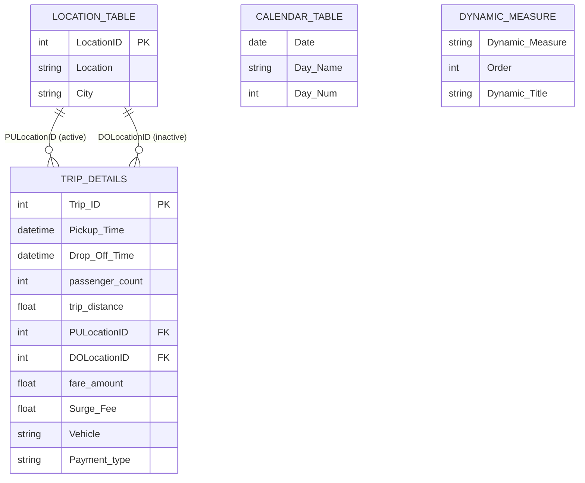

<div align="center">

# Uber Trip Analysis Dashboard

### An interactive, end-to-end Power BI report analysing 100K+ Uber trips across bookings, revenue, vehicle types, locations, and time patterns.


</div>

<!-- Add a banner / hero screenshot of your Overview page here -->
<p align="center">
  
</p>

---

## 📑 Table of Contents

- [Project Overview](#-project-overview)
- [Business Problem & Objectives](#-business-problem--objectives)
- [Dataset](#-dataset)
- [Tools & Technologies](#-tools--technologies)
- [Data Model](#-data-model)
- [Dashboard Walkthrough](#-dashboard-walkthrough)
- [Key Features](#-key-features)
- [DAX Measures](#-dax-measures)
- [Data Preparation (Power Query)](#-data-preparation-power-query)
- [Key Insights](#-key-insights)
- [How to Use This Project](#-how-to-use-this-project)
- [Repository Structure](#-repository-structure)
- [Skills Demonstrated](#-skills-demonstrated)
- [Contact](#-contact)

---

## 📌 Project Overview

This project is a **3-page interactive Power BI report** that turns raw Uber trip records into clear, decision-ready insights. It covers the full BI workflow: **data cleaning in Power Query → dimensional data modelling → DAX measures → interactive dashboard design**.

| Metric | Value |
|---|---|
| 🧾 Total Trips Analysed | **103,728** |
| 💰 Total Booking Value | **~$1.55M** |
| 🎟️ Avg. Booking Value | **~$14.98** |
| 📏 Total Distance | **~349K miles** |
| ⏱️ Avg. Trip Duration | **~16 min** |
| 📅 Period Covered | **1 – 30 June 2024** |
| 🚘 Vehicle Types | **5** (UberX, Comfort, Black, XL, Green) |
| 📍 Pickup / Drop-off Zones | **265** zones across NYC boroughs |

---

## 🎯 Business Problem & Objectives

A ride-hailing operations team needs fast answers to questions like *"When is demand highest?"*, *"Which vehicle types and locations drive the most revenue?"*, and *"How do customers pay?"* This dashboard answers them in one place.

**Questions this report answers:**

1. How many bookings are we getting, and how much revenue do they generate?
2. Which **vehicle types** contribute the most to bookings, revenue, and distance?
3. Which **pickup and drop-off locations** are the busiest?
4. How does demand change by **hour of day**, **day of week**, and **day vs. night**?
5. What is the **payment-method** mix (Uber Pay, Cash, Amazon Pay, Google Pay)?
6. Can a user drill down from KPIs into **individual trip-level records**?

---

## 🗂️ Dataset

| Source File | Description | Rows |
|---|---|---|
| `Uber Trip Details.xlsx` | Trip-level fact data | 103,728 |
| `Location Table.xlsx` | Zone lookup (ID → location name → borough/city) | 265 |

**Trip Details columns:** `Trip ID`, `Pickup Time`, `Drop Off Time`, `passenger_count`, `trip_distance`, `PULocationID`, `DOLocationID`, `fare_amount`, `Surge Fee`, `Vehicle`, `Payment_type`

**Data quality:** No null values in any trip field.

---

## 🛠️ Tools & Technologies

| Tool | Purpose |
|---|---|
| **Power BI Desktop** | Report design, modelling, interactivity |
| **Power Query (M)** | Data import, type conversion, cleaning |
| **DAX** | Measures, calculated columns, calculated tables, dynamic titles |
| **Excel** | Source data |

---

## 🧩 Data Model

A **star-schema-style model** with `Trip Details` as the fact table and dimension tables for location, date, and a helper table for dynamic measure switching.



**Modelling highlights**

- **Role-playing dimension:** `Location Table` is used for both pickup (active relationship) and drop-off (inactive relationship activated in DAX with `USERELATIONSHIP`).
- **Dedicated date table:** `Calendar Table` generated with DAX `CALENDAR()` from the min/max trip date.
- **Field-parameter table:** `Dynamic Measure` lets users switch the metric shown across multiple visuals.

---

## 📊 Dashboard Walkthrough

### 1️⃣ Overview Analysis
The executive summary page: KPI cards, payment-method split, vehicle-type matrix, and location rankings.

<p align="center">
  
</p>

- KPI cards: Total Bookings, Total Booking Value, Avg. Booking Value, Total & Avg. Distance, Avg. Trip Time
- Donut charts: payment type share and **Day vs. Night** trip split
- Matrix: bookings, value, avg. value, and distance **by vehicle type**
- Bar charts: top locations and pickup zones by vehicle
- Area chart: booking trend over time
- Smart cards: **Most Frequent Pickup**, **Most Frequent Drop-off**, and **Farthest Trip**

### 2️⃣ Time Analysis
Shows *when* demand happens.

<p align="center">
  
</p>

- Bookings by **pickup time** (10-minute bins)
- Bookings by **day of week**
- Bookings by **hour of day**
- **Hour × Day** matrix to spot peak windows
- All visuals respond to the metric switcher (Bookings / Booking Value / Distance)

### 3️⃣ Details (Drill-through)
A trip-level table (Trip ID, pickup date/hour, location, vehicle, payment type, passengers, value, distance) reachable by drill-through, with a back button.

<p align="center">
  
</p>

---

## ✨ Key Features

| Feature | Description |
|---|---|
| 🔄 **Dynamic metric switcher** | One slicer toggles visuals between *Total Bookings*, *Total Booking Value*, and *Total Trip Distance* using a `NAMEOF()` field-parameter table |
| 🏷️ **Dynamic chart titles** | Titles update automatically to match the selected metric via `SELECTEDVALUE()` |
| 🔍 **Drill-through** | Jump from the overview to granular trip-level data |
| 🔖 **Bookmarks** | 7 bookmarks drive navigation and show/hide panels (e.g. data-field info panel) |
| 🧭 **Custom navigation** | Icon-based side menu + page navigator for an app-like experience |
| 🎛️ **Global filters** | Date-range (*Between*) slicer and City dropdown on analysis pages |
| 🌗 **Day / Night segmentation** | Calculated column classifying trips by pickup hour |
| 📍 **Role-playing dimension** | Pickup and drop-off analysis from a single location table |
| 🎨 **Custom UI** | Branded layout with Uber logo, icons, rounded containers, and consistent theme (Fluent 2 base) |

---

## 🧮 DAX Measures

<details>
<summary><b>Core KPIs</b></summary>

```dax
Total Bookings = COUNT('Trip Details'[Trip ID])

Total Booking Value =
SUM('Trip Details'[fare_amount]) + SUM('Trip Details'[Surge Fee])

Avg Booking Value =
DIVIDE([Total Booking Value], [Total Bookings], BLANK())

Average Trip Time =
VAR AvgTime =
    AVERAGEX(
        'Trip Details',
        DATEDIFF('Trip Details'[Pickup Time], 'Trip Details'[Drop Off Time], MINUTE)
    )
RETURN
    CONCATENATE(FORMAT(AvgTime, "0"), " min")
```
</details>

<details>
<summary><b>Most Frequent Drop-off Point (inactive relationship + RANKX)</b></summary>

```dax
Most Frequent Dropoff Point =
VAR DropOffCounts =
    ADDCOLUMNS(
        SUMMARIZE('Trip Details', 'Location Table'[Location]),
        "DropOffCount",
            CALCULATE(
                COUNT('Trip Details'[Trip ID]),
                USERELATIONSHIP('Trip Details'[DOLocationID], 'Location Table'[LocationID])
            )
    )
VAR RankedDropoffs =
    ADDCOLUMNS(DropOffCounts, "Rank", RANKX(DropOffCounts, [DropOffCount], , DESC, Dense))
VAR TopDropOff =
    FILTER(RankedDropoffs, [Rank] = 1)
RETURN
    CONCATENATEX(TopDropOff, 'Location Table'[Location], ",")
```
</details>

<details>
<summary><b>Farthest Trip (variables + LOOKUPVALUE)</b></summary>

```dax
Farthest Trip =
VAR MaxDistance = MAX('Trip Details'[trip_distance])
VAR PickupLocation =
    LOOKUPVALUE(
        'Location Table'[Location],
        'Location Table'[LocationID],
        CALCULATE(SELECTEDVALUE('Trip Details'[PULocationID]),
                  'Trip Details'[trip_distance] = MaxDistance)
    )
VAR DropoffLocation =
    LOOKUPVALUE(
        'Location Table'[Location],
        'Location Table'[LocationID],
        CALCULATE(SELECTEDVALUE('Trip Details'[DOLocationID]),
                  'Trip Details'[trip_distance] = MaxDistance)
    )
RETURN
    "Pickup: " & PickupLocation & "-> Drop-Off : " & DropoffLocation
        & " (" & FORMAT(MaxDistance, "0.0") & " miles)"
```
</details>

<details>
<summary><b>Calculated columns & tables</b></summary>

```dax
-- Day / Night classification
Trip(Day / Night) =
VAR HourofDay = HOUR('Trip Details'[Pickup Time])
RETURN IF(HourofDay >= 17 || HourofDay <= 6, "Night Trip", "Day Trip")

-- 10-minute time bins
Pickup Hour (bins) =
IF(
    ISBLANK('Trip Details'[Pickup Hour (HH MM SS)]),
    BLANK(),
    (INT(('Trip Details'[Pickup Hour (HH MM SS)] * 1440) / 10) * 10) / 1440
)

-- Date dimension
Calendar Table = CALENDAR(MIN('Trip Details'[Pickup Date]), MAX('Trip Details'[Pickup Date]))

-- Dynamic metric switcher (field parameter)
Dynamic Measure = {
    ("Total Bookings",       NAMEOF('Trip Details'[Total Bookings]),               0),
    ("Total Booking Value",  NAMEOF('Trip Details'[Total Booking Value]),          1),
    ("Total Trip Distance",  NAMEOF('Trip Details'[Total Trip Distance Measure]),  2)
}
```
</details>

---

## 🧹 Data Preparation (Power Query)

- Imported two Excel sources and **promoted headers**
- Enforced correct **data types** (integers, decimals, datetime, text)
- **Standardised missing city values** in `Location Table` (`N/A` → `Not Specified`)
- Derived **Pickup Date**, **Pickup Hour**, and **time-bin** columns for time-series analysis
- Built a **Calendar table** with day name and weekday number for correct day-of-week sorting

---

## 💡 Key Insights

> Insights below are calculated from the data in this report (June 2024).

- 🚕 **UberX dominates** – it accounts for ~**37%** of all bookings and booking value, more than any other tier.
- 💳 **Digital payments lead** – Uber Pay covers ~**67%** of trips (~71% of revenue), Cash ~32%, while Amazon Pay and Google Pay together are under 1%.
- ⏰ **Afternoon is peak time** – demand builds from 7 AM, plateaus between **12 PM and 6 PM**, and peaks at **3 PM (≈7.9K trips)**. The quietest hour is 4 AM.
- ☀️ **Day beats night** – ~**63%** of trips are day trips vs. ~37% night trips.
- 🏙️ **Manhattan drives demand** – ~**62%** of pickups start in Manhattan; **Penn Station / Madison Sq West** is the busiest pickup zone and **Upper East Side North** the busiest drop-off zone.
- 📈 **Weekend volume is highest** – Sunday (~19.2K) and Saturday (~18.7K) lead; Friday is lowest (~9.3K). *(June 2024 contains five Saturdays and five Sundays, so per-day averages are the fairer comparison.)*
- 💵 **Pricing looks uniform across tiers** – average booking value sits at ~$15 for every vehicle type, so revenue differences come from trip *volume*, not price.
- ⚠️ **Outlier detected** – the farthest trip is **144.1 miles** (~$564 fare, ~8.9 hours), far above the 3.4-mile average and worth flagging for review.

---

## 🚀 How to Use This Project

### Prerequisites
- [Power BI Desktop](https://powerbi.microsoft.com/desktop/) (free, Windows)

### Steps
1. **Clone the repository**
   ```bash
   git clone https://github.com/<your-username>/<your-repo-name>.git
   ```
2. **Open** `Uber_Power_BI_Project.pbix` in Power BI Desktop.
3. The data is **already embedded** in the file, so the report works immediately — no setup needed.
4. *(Optional – to refresh data)* If you want to refresh from the source Excel files, go to **Home → Transform data → Data source settings** and point `Uber Trip Details.xlsx` and `Location Table.xlsx` to their location on your machine.

### Navigating the report
- Use the **left sidebar** to switch between pages.
- Use the **City** and **Date** slicers (top right) to filter.
- Use the **metric switcher** to flip between Bookings, Value, and Distance.
- **Right-click** a visual → **Drill through → Details** to see trip-level records.

---

## 📁 Repository Structure

```
📦 uber-power-bi-dashboard
 ┣ 📜 Uber_Power_BI_Project.pbix     # Power BI report (data model + dashboard)
 ┣ 📜 README.md                      # Project documentation
 ┣ 📂 Screenshot                        # Dashboard screenshots used in this README
 ┃ ┣ 🖼️ overview-dashboard.png
 ┃ ┣ 🖼️ time-analysis.png
 ┃ ┗ 🖼️ details-page.png
 ┗ 📂 data                           # (optional) source Excel files
   ┣ 📄 Uber Trip Details.xlsx
   ┗ 📄 Location Table.xlsx
```

---

## 🧠 Skills Demonstrated

- **Data Cleaning & Transformation** – Power Query (M)
- **Data Modelling** – star schema, relationships, role-playing dimensions
- **Advanced DAX** – variables, `CALCULATE`, `USERELATIONSHIP`, `RANKX`, `TOPN`, `LOOKUPVALUE`, `AVERAGEX`, `SELECTEDVALUE`, `NAMEOF`
- **Dashboard Design & UX** – navigation, bookmarks, drill-through, dynamic titles, consistent branding
- **Business Storytelling** – translating raw data into actionable insights

---

## 📬 Contact

**[Mannatpreet Kaur]**
Data Analyst | Power BI | Excel

[](https://www.linkedin.com/in/mannatpreet-kaur75/?isSelfProfile=true)
[](mannatarora705@gmail.com)

---

<div align="center">

⭐ **If you found this project helpful, please consider giving it a star!** ⭐

</div>
